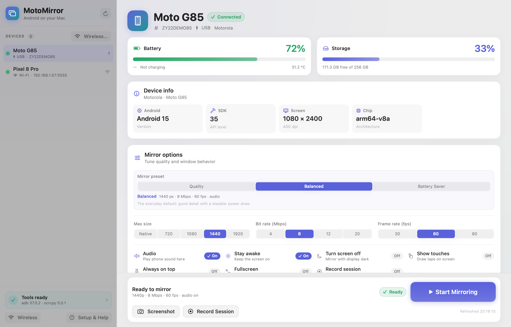

# MotoMirror

MotoMirror mirrors an Android phone on a Mac. It is a native SwiftUI app that
drives `adb` and `scrcpy`. It is built for the Moto G85 and works with any
Android 11+ device.



> The screenshot uses the app's demo state with sample Moto G85 data. The live
> emulator run renders the same interface with real device values. See
> `docs/live-emulator.png` and `docs/mirror-frame.png` for the live proof.

## Requirements

- macOS 13 Ventura or newer.
- Android 11 or newer. The Moto G85 is supported.
- A USB-C cable that carries data. Charge-only cables do not work.
- Xcode Command Line Tools to build: `xcode-select --install`.
- Homebrew for `make setup`.

For wireless mirroring, the Mac and the phone must be on the same Wi-Fi network.

## Quick start

From the repository folder:

```bash
make setup
make app
open dist/MotoMirror.app
```

`make setup` installs `scrcpy` and Android platform-tools with Homebrew when
they are missing. `make app` builds `dist/MotoMirror.app`, generates the icon,
and signs the app locally. No sudo is needed.

To copy the app into your Applications folder:

```bash
make install
open ~/Applications/MotoMirror.app
```

`make install` builds first, then copies the app. Add `--open` when calling the
script directly to launch it after install:

```bash
./scripts/install.sh --open
```

## Enable USB debugging on the Moto G85

1. Connect the phone to the Mac with a USB-C data cable.
2. Open **Settings > About phone**.
3. Tap **Build number** seven times. Enter your PIN or pattern when asked.
4. Open **Settings > System > Developer options**.
5. Turn on **USB debugging**.
6. Unlock the phone and watch the screen. A dialog titled **Allow USB
   debugging?** shows an RSA key fingerprint.
7. Check **Always allow from this computer** and tap **Allow**.
8. On the Mac, verify the connection:

```bash
adb devices -l
```

A working USB device looks like this:

```text
List of devices attached
ZY22ABCDEF    device usb:1-2 product:... model:Moto_G_85 device:... transport_id:1
```

If the list is empty, see [Troubleshooting](#troubleshooting) and
`docs/SETUP-MOTO-G85.md`.

## Wireless debugging

### Pair in the app (recommended)

1. Keep the phone and the Mac on the same Wi-Fi network. Turn off VPNs.
2. On the phone, open **Settings > System > Developer options > Wireless
   debugging** and turn it on.
3. Tap **Pair device with pairing code** and leave that dialog open. It shows a
   pairing address like `192.168.1.42:37123` and a six-digit code.
4. In MotoMirror, click **Wireless…**, then **Discover**. The app reads
   Android's mDNS pairing advertisement and fills the host and both ports. Enter
   the six-digit code and click **Pair & Connect**.
5. Pick the phone in the sidebar and click **Start Mirroring**. MotoMirror
   remembers the wireless endpoint. If Wi-Fi drops, it re-runs `adb connect` and
   restarts the mirror when the phone returns.

The CLI exposes the same discovery step for diagnostics:

```bash
motomirrorctl wireless discover --json
```

### Pair with the CLI (Android 11+)

1. Keep the phone and the Mac on the same Wi-Fi network. Turn off VPNs.
2. On the phone, open **Settings > System > Developer options > Wireless
   debugging** and turn it on.
3. Tap **Pair device with pairing code**. The phone shows a pairing address
   like `192.168.1.42:37123` and a six-digit code.
4. On the Mac, run the command with the address from the phone:

```bash
adb pair 192.168.1.42:37123
```

Enter the six-digit code when prompted.

5. Go back to the **Wireless debugging** screen. Find the IP address and port
   under **IP address & Port**. This port is not the pairing port. Connect:

```bash
adb connect 192.168.1.42:5555
adb devices -l
```

MotoMirror also exposes the same pairing flow in its Wireless panel.

### Alternative: switch a USB connection to TCP/IP

Works on Android 11+ and keeps port 5555 until the phone reboots.

1. Connect the phone over USB and authorize it. Confirm with `adb devices -l`.
2. Switch the USB daemon to TCP/IP:

```bash
adb tcpip 5555
```

3. Find the phone IP address on **Settings > About phone > Status > IP
   address**, or read it from the routing table:

```bash
adb shell ip route
```

The address after `src` is the phone IP, for example `192.168.1.42`.

4. Connect and unplug the USB cable:

```bash
adb connect 192.168.1.42:5555
adb devices -l
```

## Features

- Native SwiftUI device list with USB and wireless transports.
- Device detail panel: model, Android version, battery, storage, screen size.
- Live mirror through scrcpy 5.0.1.
- Bitrate, resolution, FPS, audio, stay-awake, and window options.
- Screenshot capture and MP4 recording.
- Wireless pairing with `adb pair` and `adb connect`.
- Automatic reconnect after a dropped USB or wireless session.
- In-app setup guidance for developer options, USB debugging, and RSA prompts.
- Logs for every adb and scrcpy command.
- `motomirrorctl` command line tool.
- Demo mode with sample devices for UI review without a phone.

## Troubleshooting

| Symptom | Fix |
| --- | --- |
| `unauthorized` in `adb devices -l` | Unlock the phone and tap **Allow** on the RSA dialog. Enable **Always allow from this computer**. Then run `adb kill-server && adb start-server`. |
| Device shows `offline` | Replug the cable. Run `adb reconnect offline`. Turn USB debugging off and on. |
| `adb` not found | Run `make setup`. Open a new terminal. Check `which adb`; Homebrew installs it in `/opt/homebrew/bin`. |
| Black screen | Unlock the phone and accept the RSA prompt. Keep the screen on. Apps with `FLAG_SECURE` block capture. |
| No audio | Audio needs Android 11+ and scrcpy 5.x. Raise the phone media volume. Check the app audio toggle. Try USB instead of wireless. |
| Wireless drops | Use the same non-guest Wi-Fi network. Turn off VPN. Reconnect with `adb connect <ip>:<port>`. MotoMirror retries automatically. |
| Phone not listed after plugging in | Use a data cable, not a charge-only cable. Try another USB port without a hub. See `docs/SETUP-MOTO-G85.md`. |

## Verification

Run the offline checks:

```bash
make verify
```

Run the live suite against the Moto G85:

```bash
make verify-live
```

The live target expands to:

```bash
./scripts/verify.sh --live --target moto --wait-for-device 120
```

The suite runs 100 weighted checks. It covers the build, tool discovery, device
parsing, command construction, live mirroring, screenshot capture, recording,
and cleanup. The live run starts scrcpy and waits up to 120 seconds for the
phone. The pass bar is **99/100 with zero failed checks**. Reports and evidence
are written under `verification/`.

### Current verification status

- Static gate: **58/58** checks.
- Unit tests: **111 tests, 0 failures**.
- Live gate on Android 15 (Google APIs emulator, 1080x2400): **100/100**, run `20261109-180730`.
- Live mirror proof: H.264 video at 1080x2400 with 124 frames, plus Opus audio.
- Wireless proof: connect, screenshot, mirror, and disconnect over
  `127.0.0.1:5555`.
- Wireless reconnect proof: after `adb disconnect 127.0.0.1:5555`, the app
  re-ran `adb connect` and a new scrcpy child started on the wireless serial.
- mDNS discovery parser: 9 tests, plus `motomirrorctl wireless discover --json`.
- Auto-reconnect proof: killing the scrcpy child under a running app produced
  a new scrcpy child with the same parent.
- Physical Moto G85 gate: pending the phone. Run `make verify-live` with the
  phone connected and USB debugging authorized.

The emulator run proves the full pipeline, but it cannot prove the Moto-specific
model and USB checks. Those are the final three points of the physical gate.
The app warns instead of claiming success when the phone is absent.

For a continuous gate while the phone is connected:

```bash
./scripts/verify-loop.sh 0 600
```

The first argument is the attempt count (`0` means forever) and the second is
the delay in seconds between attempts. Every attempt writes a fresh
`verification/REPORT.md` and exits nonzero until the gate reaches 99/100.

## Architecture

```text
Sources/MotoMirror       SwiftUI app, windows, views, app state
Sources/MotoMirrorCore   Models, binary locator, ADB service, scrcpy command
                         builder, process runner
Sources/MotoMirrorCLI    motomirrorctl command line tool
Resources                Info.plist and generated app icon
scripts                  Setup, app packaging, installer, icon, verification
```

MotoMirror does not reimplement screen capture. It starts `scrcpy` as a child
process and controls it through command line options. It uses `adb` for device
discovery, screenshots, wireless setup, and device details.

## Privacy

All work stays on the Mac and the phone. There is no account, no cloud service,
and no telemetry. ADB connects over USB or the local network. Screenshots and
recordings stay on the Mac.

## Uninstall

```bash
rm -rf ~/Applications/MotoMirror.app
defaults delete com.srihari.motomirror 2>/dev/null || true
```

Remove build output from the repository:

```bash
make clean
```

## License

MIT. Copyright 2026 Srihari. See [LICENSE](LICENSE).
