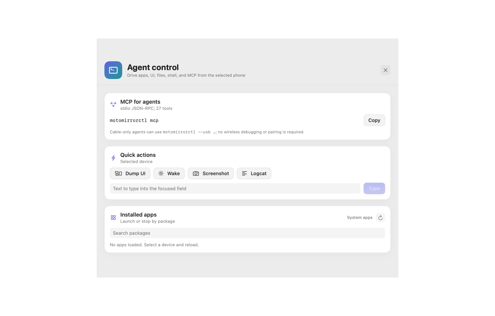

# Agent control

MotoMirror is scriptable from the command line and from MCP. Everything is
local to the Mac. No cloud account is involved.



## Quick start

```bash
# Build and install the CLI once
make install-cli

# Use the connected phone. The serial is optional when one device is present.
motomirrorctl apps list --system --json
motomirrorctl apps current --json
motomirrorctl apps launch com.android.settings
motomirrorctl ui dump --json
motomirrorctl ui find --text "Search settings" --json
motomirrorctl ui tap --text "Search settings"
motomirrorctl ui text "battery"
motomirrorctl ui key KEYCODE_BACK
motomirrorctl ui swipe 540 1600 540 800
motomirrorctl screenshot --out /tmp/phone.png
motomirrorctl files push ./local.txt /sdcard/Download/local.txt
motomirrorctl files pull /sdcard/Download/local.txt ./pulled.txt
motomirrorctl shell echo hello
motomirrorctl logcat -n 100
motomirrorctl screen wake
motomirrorctl volume get
motomirrorctl wait-for app com.android.settings --timeout 10
motomirrorctl open https://example.com
```

Add `--serial SERIAL` to target one device. Add `--json` where offered for
machine-readable output.

## USB only, no wireless debugging

Use `--usb` or set `MOTOMIRROR_TRANSPORT=usb`:

```bash
motomirrorctl --usb apps list
```

This filters to USB devices and fails clearly when no cable is connected. It
does not pair, does not use mDNS, and does not require Wireless debugging. In
the app, enable **Settings → USB only**. The sidebar hides wireless actions and
the app stops mDNS recovery.

## MCP server

`motomirrorctl mcp` is a stdio JSON-RPC MCP server. It exposes 27 tools,
including:

`devices_list`, `device_info`, `screenshot`, `apps_list`, `apps_current`,
`apps_launch`, `apps_stop`, `apps_install`, `apps_uninstall`, `open_url`,
`ui_dump`, `ui_find`, `ui_tap`, `input_text`, `input_key`, `swipe`,
`files_push`, `files_pull`, `files_ls`, `shell`, `screen`, `volume`, `logcat`,
`wait_for_app`, `mirror_start`, `mirror_stop`, `mirror_status`.

Example MCP client configuration:

```json
{
  "mcpServers": {
    "motomirror": {
      "command": "/Users/srihari/.local/bin/motomirrorctl",
      "args": ["mcp"]
    }
  }
}
```

Every device tool accepts an optional `serial`. Without it, the first usable
device is used. Pass a serial when more than one phone or emulator is
connected.

Example tool call:

```json
{"name":"apps_launch","arguments":{"serial":"192.168.1.42:5555","package":"com.android.settings"}}
```

Inspect the schemas:

```bash
motomirrorctl agent tools --json
```

Call one tool without an MCP client:

```bash
motomirrorctl agent call ui_dump --args '{"serial":"emulator-5554"}' --json
```

## Agent recipes

Open an app and wait for it:

```bash
motomirrorctl apps launch com.android.settings
motomirrorctl wait-for app com.android.settings --timeout 10
```

Find and press a button:

```bash
motomirrorctl ui find --text "Battery" --json
motomirrorctl ui tap --text "Battery"
```

Capture the result:

```bash
motomirrorctl screenshot --out /tmp/result.png
motomirrorctl logcat -n 100
```

Use a cable for an agent that must not depend on Wi-Fi:

```bash
motomirrorctl --usb apps current
```

## Feature matrix

| Feature | Command or tool | Live tested |
| --- | --- | --- |
| Installed apps | `apps list` | yes |
| Foreground app | `apps current` | yes |
| Launch app | `apps launch` | yes |
| Stop app | `apps stop` | no (package exists) |
| Install/uninstall APK | `apps install`, `apps uninstall` | no |
| Open URL/deep link | `open` | yes |
| UI hierarchy | `ui dump` | yes |
| Find element | `ui find` | yes |
| Tap element/coordinates | `ui tap` | yes |
| Type text | `ui text` | yes |
| Key event | `ui key` | yes |
| Swipe | `ui swipe` | yes |
| Screenshot | `screenshot` | yes |
| Push/pull/list files | `files` | yes |
| Shell | `shell` | yes |
| Wake/sleep/rotate | `screen` | yes |
| Media volume | `volume` | yes |
| Logcat | `logcat` | yes |
| Wait for app/device | `wait-for` | yes |
| Tool schemas | `agent tools` | yes |
| One-shot tool call | `agent call` | yes |
| MCP server | `mcp` | yes |
| USB-only transport | `--usb` | yes (guard) |
| Agent panel in app | App sidebar → Agent | UI verified |

## Safety

- The MCP server and HTTP-free CLI run locally. Do not expose them over a
  network.
- `shell` runs arbitrary commands on the phone with the phone's shell user.
  Treat it like a local terminal.
- `apps install` only installs a local APK path; `apps uninstall` removes a
  package.
- `screen sleep` can turn the phone display off. Use `screen wake` to restore.
- `volume set` clamps to the device's reported maximum.

## Verification

Run the live agent suite on the isolated emulator:

```bash
python3 verify/agent_features.py
```

It writes `verification/AGENT-FEATURES.md` and `verification/agent-features.json`.
The suite covers 21 checks and never selects the Moto G85.
